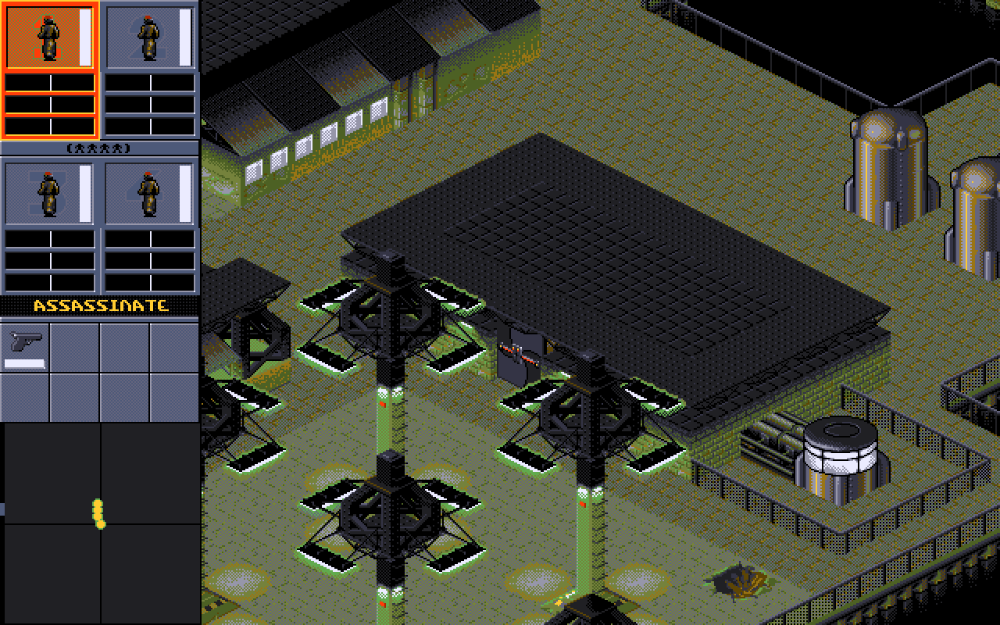
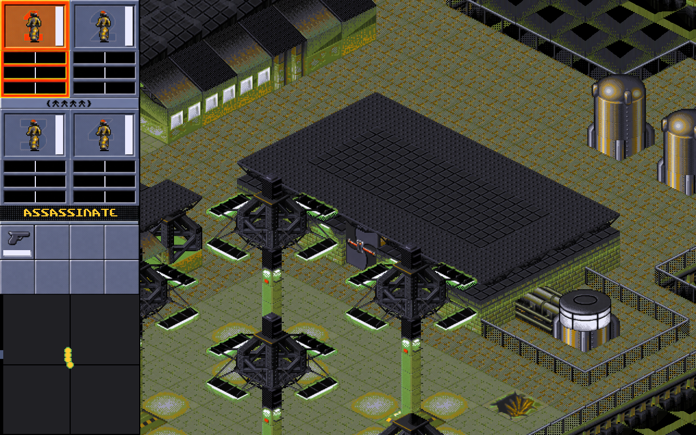
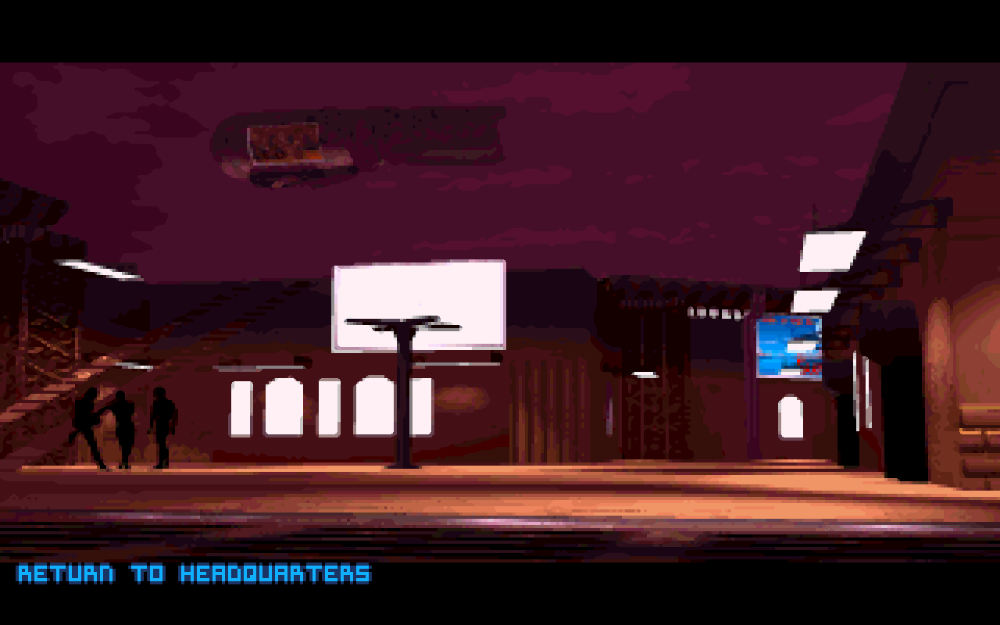

# FreeSynd HD

**You need a legally obtained copy of the original Syndicate to play.** The installer reads the base game's DATA directory from your own installation. The project supplies the modified engine and HD artwork. The original missions, game data and opening movie must come from your copy.

This fan project is a fork of [CeRiAl/freesynd](https://github.com/CeRiAl/freesynd). Credit for the engine belongs to the FreeSynd contributors, and credit for the original Syndicate game and art belongs to Bullfrog Productions. The upstream mirror remains at the repository root. The Windows HD build in `remaster/` uses the FreeSynd 0.8 source release, which has a newer engine layout than the mirror.

## Screenshots

The following two captures show the **same gameplay frame**. The agent panel, roof and street occupy the same positions in both images.

| Original graphics | HD graphics |
| --- | --- |
|  |  |

The opening movie is decoded from the player's original INTRO.DAT. The player scales each frame to 1280×800 using two edge-aware Scale2x passes. The screenshot shows frame 300 with the original English subtitle.



## Play on Windows

1. Download this repository or clone it. Install Python 3.8 or later.
2. From the repository root, run the following command. Replace the example path with the base game's DATA directory from your installation.

   ```powershell
   python remaster/install.py "C:\Program Files\GOG Galaxy\Games\Syndicate Plus\SYNDICAT\DATA"
   ```

3. Open `remaster/play/Syndicate-HD.exe`. The normal launch plays the opening cinematic in fullscreen. Press a key to advance past the title screen. To jump directly to the first mission briefing, use `Launch-First-Mission.cmd` in the same folder.
4. During a mission, press **H** to switch the HD layer on or off. The logical camera is 640×400 and the renderer produces a 1280×800 frame. On an ultrawide monitor the image retains its proportions.

## What changed

- The renderer matches terrain tiles by index and sprites by a hash of their original indexed pixels. High-resolution replacements follow the original camera, palette and sprite positions. Missing replacements fall back to the original artwork.
- The art packs cover 256 terrain tiles and replacements for 1,890 distinct sprite images, plus menu backgrounds. AI-assisted texture work was registered against the original art. 643 glyph assets use crisp enlargement from their original masks.
- The cinematic uses the game's frame timing, palette and subtitles. The opening was tested through all 997 frames. Gameplay and menus have been spot-checked; the full campaign has yet to be verified.
- The Windows build includes a PCM decoding fix for Creative Voice samples. Fullscreen and intro playback are enabled by default; the intro setting persists across launches.

## Build the modified engine

The corresponding source is the bundled upstream FreeSynd 0.8 source archive plus the readable files in `remaster/overlay/`. The archive also contains the upstream authors, license notices, engine data and import libraries. The overlay includes the renderer, cinematic playback and startup changes. The upstream source archive SHA-256 is `a73de4657c5d945e338a14b915ccd976c473f9da5a965f0dc22fb2a233a5158b`.

Install Python and LLVM-MinGW with the i686 Windows target. From the repository root run the following command, replacing the compiler path with your own.

```powershell
python remaster/build_windows.py --compiler "C:\Tools\llvm-mingw\bin\clang++.exe"
```

The script extracts the source, applies the overlay and produces `remaster/build/Syndicate-HD.exe`. To test it with your installed data and art, copy that executable into `remaster/play/` after running the installer.

## Credits

[CeRiAl/freesynd](https://github.com/CeRiAl/freesynd) is the parent repository. [The FreeSynd project](https://freesynd.sourceforge.io/) developed the engine. Contributor acknowledgements and the engine's GPL license are in [AUTHORS](AUTHORS) and [COPYING](COPYING). The HD changes and screenshots document this fork's Windows experiment. The original game's commercial assets are required separately.
